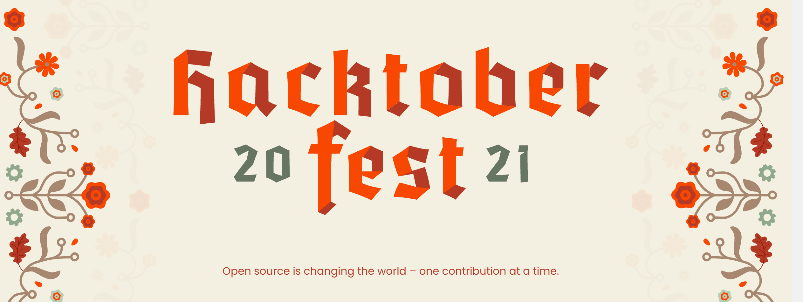

# Hacktoberfest 2021

SpeakCode participated in Hacktoberfest in October 2021. This page is kept as a record of that.

## What it was

Over 100k people from all over the world participate in Hacktoberfest every October by going to GitHub, choosing a repository, and contributing to it.

Contributions are made by submitting a pull request to a participating repository. In 2021, four accepted pull requests were required to complete the event.

## Note on the rules

The rules have changed since 2021. Maintainers now opt repositories in, low-quality PRs are handled differently, and the requirements shift year to year. Check the current Hacktoberfest site before using anything on this page as instructions.

## Still open

The [learning-path.md](./learning-path.md) contribution is not tied to October. It stays open year round.
